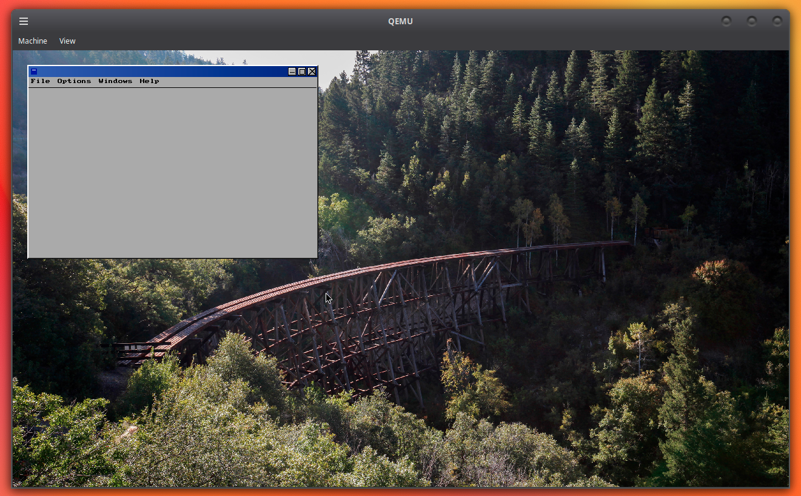

<h2>discouNT operating system</h2>

 
<i>discouNT with Program Manager open (720p)</i>
  

discouNT is a from-scratch operating system designed to be compatible with Windows NT.

Although it uses some code from WINE and ReactOS, **it is not a fork of either.**

### Supported architectures and hardware

discouNT currently supports x86, AMD64 and LoongArch64.

discouNT supports IDE and SATA CD and hard drives, with experimental support for USB.

discouNT can theoretically be booted on real x86 and AMD64 hardware, though I do not know if it is bootable on real LA64 hardware.

### Building

#### x86, AMD64 and LoongArch64

You will need NASM, Flex and Clang.

#### i960 (WIP)

If you want to build for i960, install the i960 SDK from [Pyrite](https://j.nishi.boats/job/pyrite-dev/job/i960-sdk/job/master/lastSuccessfulBuild/)

### Credits

Microsoft - WDF source (/compat/wdf)

ReactOS team - MSGINA source (/dlls/msgina), winineet source (dlls/wininet)

WINE team - Basically all of the user-mode apps (/apps)